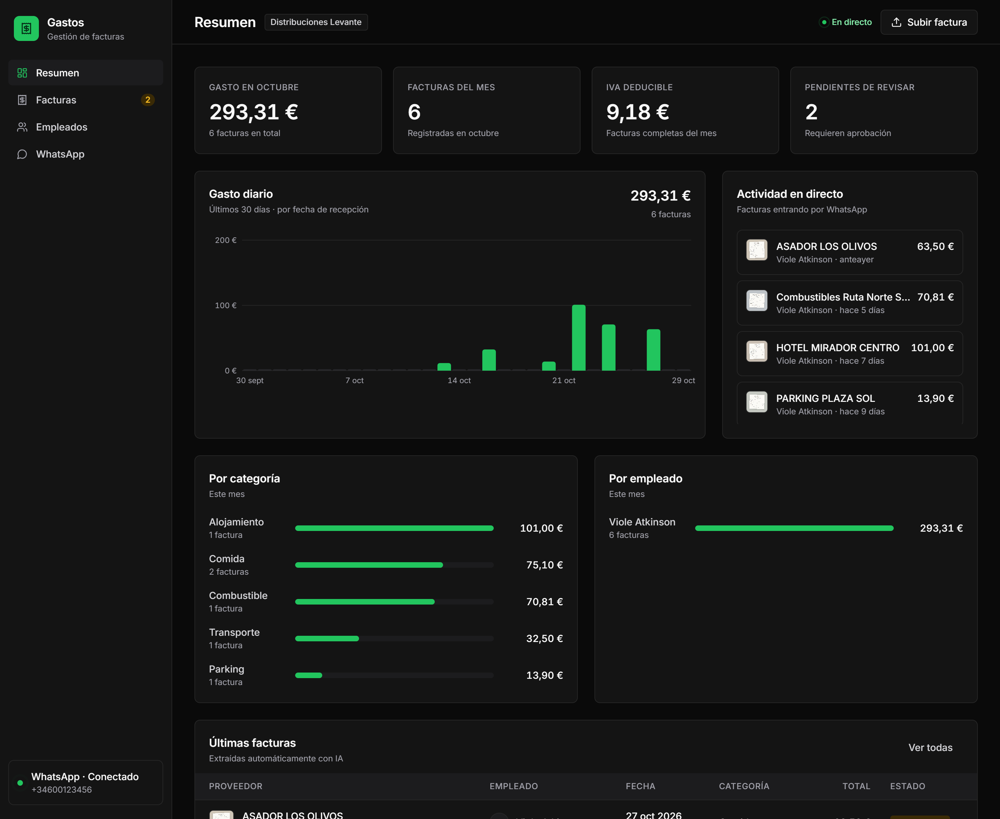
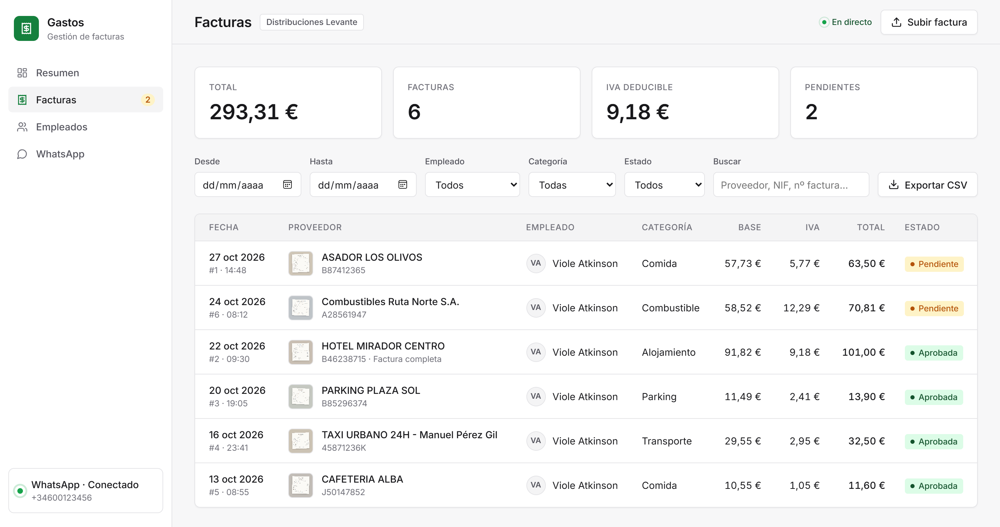
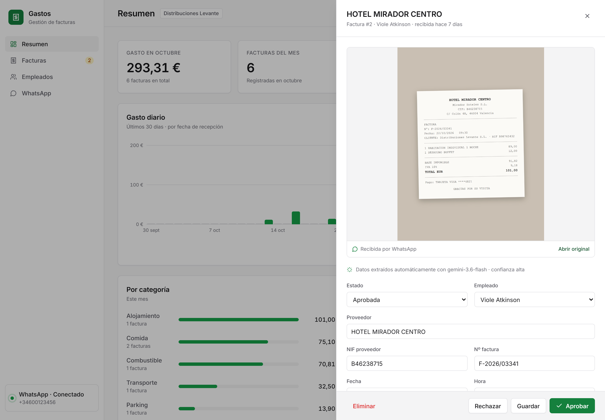
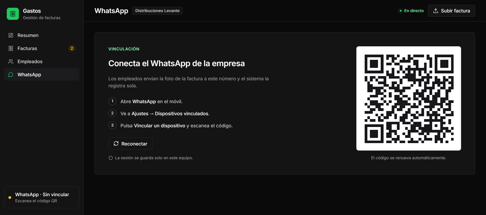
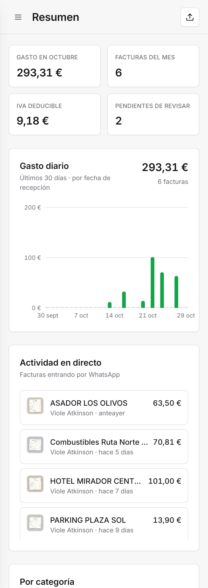

# Expenses WhatsApp IA

**Automated employee expense management: send a photo of a receipt over WhatsApp, AI extracts the accounting data, and it shows up instantly in a web dashboard.**



> The dashboard and the bot are in Spanish: the product targets companies in Spain (Spanish VAT rules, NIF/CIF tax IDs, simplified invoices).

## The problem

Sales reps and field technicians who travel pile up receipts from restaurants, gas stations, hotels, parking lots and tolls. Today companies have two options, and neither works well:

- **Typing receipts in by hand**, line by line, into the accounting system. It's slow and error-prone.
- **Rolling out a subscription expense app** that employees end up forgetting to use.

## The solution

Employees already have WhatsApp open all day. All they have to do is **snap a photo of the receipt and send it to a company number**:

1. The bot receives the image (or PDF) and replies right away.
2. **Gemini** (Google's vision-capable AI) reads the receipt and extracts the merchant, tax ID, invoice number, date and time, net amount, VAT breakdown, total, tip, payment method and expense category.
3. The bot **confirms in the chat** with a summary of the data.
4. The receipt **appears in the web dashboard in real time**, with the original image, without reloading the page.
5. The admin reviews, approves or rejects, and **exports to CSV** for the accounting software.

```
Employee ──photo──▶ WhatsApp ──▶ Gemini (vision) ──▶ Database ──▶ Real-time dashboard ──▶ CSV / ERP
          ◀──── confirmation with the breakdown ────┘
```

## What this MVP is for

It's a **minimum viable product built for live client demos**. It works end to end and runs on a single computer, with no servers or complex setup:

- **Validate the idea** with real companies: the employee experience (sending a photo on WhatsApp) is the same one they'd have in production.
- **Show the value live**: the client sends a receipt from their own phone and watches it appear in the dashboard about 3 seconds later.
- **Serve as the technical foundation** for a production version: the processing pipeline and the database are already decoupled from the WhatsApp channel.

## Features

**On WhatsApp**
- Linking by **scanning a QR code from the dashboard**, just like WhatsApp Web.
- Accepts photos (JPG, PNG, WEBP) and PDFs.
- Reacts with ⏳ when a receipt arrives and ✅ once it's saved, then replies with the breakdown.
- Commands: **resumen** (monthly spend), **borrar** (deletes the last pending receipt) and **ayuda** (help).
- Warns when the image isn't a receipt, is unreadable, or looks like a duplicate.
- To test with a single phone, just send the photo to yourself in the "You" (message yourself) chat.

**In the web dashboard**
- **Real time**: notifications and a live activity feed while the receipt is processed (received → reading with AI → saved).
- **Overview**: monthly spend, number of receipts, deductible VAT, receipts pending review, daily spend over the last 30 days, and breakdowns by category and by employee.
- **Receipts**: list with a thumbnail of the image, filters (dates, employee, category, status, search) and CSV export compatible with Spanish-locale Excel.
- **Receipt detail**: the original image next to the extracted data, all editable. Review warnings when the reading has low confidence or the amounts don't add up. Approve and reject buttons.
- **Employees**: registered automatically with their WhatsApp profile name when they send their first receipt; they can also be added by hand.
- **Manual upload**: dragging an image or PDF onto the dashboard processes it exactly as if it had arrived over WhatsApp.
- Corporate dark design, responsive down to mobile.

## Screenshots

**Receipt list**, with the image received over WhatsApp, the extracted amounts and the review status:



**Receipt detail**: the original image next to the data read by the AI, ready to review and approve:



**Linking WhatsApp** by scanning the QR code from the dashboard:



**On mobile**:



*The screenshots use sample receipts from fictional merchants, processed by Gemini through the same pipeline as real ones.*

## Getting started

Requirements: **Node.js 24 or later** and a **Gemini API key** (free from [Google AI Studio](https://aistudio.google.com/apikey)).

```bash
git clone https://github.com/violetaatkinson/gastos-whatsapp-ia.git
cd gastos-whatsapp-ia
npm install
cp .env.example .env      # then paste your key into GEMINI_API_KEY
npm start
```

1. Open <http://localhost:3000>. The first time, it shows the QR code.
2. On your phone: **WhatsApp → Settings → Linked devices → Link a device** and scan the code.
3. Send a photo of a receipt to that number (or to yourself in the "You" chat).

The WhatsApp session is stored on your computer, so you don't need to scan again on every start.
