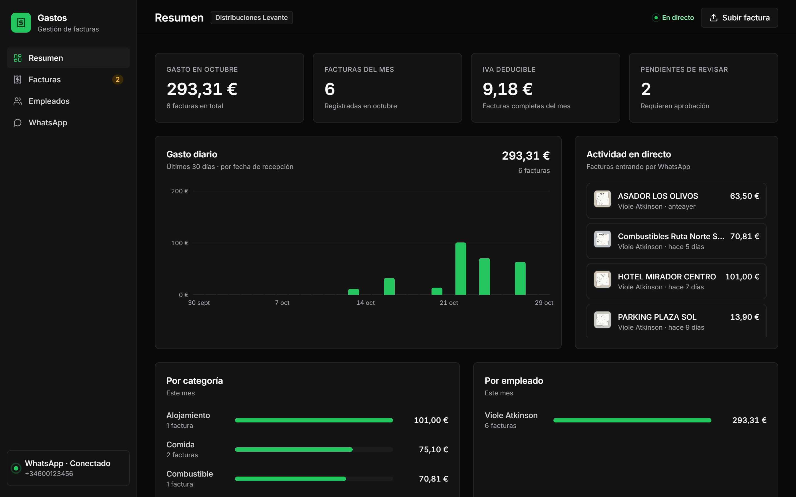

# Gastos WhatsApp IA

**Gestión automática de gastos de empleados: envías la foto de la factura por WhatsApp, la IA extrae los datos contables y aparecen al instante en un panel web.**


## El problema

Los comerciales y técnicos que viajan acumulan facturas de restaurantes, gasolineras, hoteles, parkings y peajes. Hoy la empresa tiene dos opciones, y ninguna funciona bien:

- **Meter las facturas a mano**, línea a línea, en el sistema contable. Es lento y da errores.
- **Instalar una app de gastos por suscripción** que los empleados acaban olvidando.

## La solución

El empleado ya tiene WhatsApp abierto todo el día. Solo tiene que **hacer una foto a la factura y enviarla a un número de la empresa**:

1. El bot recibe la imagen (o el PDF) y responde al momento.
2. **Gemini** (IA de Google con visión) lee la factura y extrae proveedor, NIF, número, fecha y hora, base imponible, desglose de IVA, total, propina, forma de pago y categoría del gasto.
3. El bot **confirma en el chat** con el resumen de los datos.
4. La factura **aparece en el panel web en tiempo real**, con la imagen original, sin recargar la página.
5. Administración revisa, aprueba o rechaza, y **exporta a CSV** para el programa contable.

```
Empleado ──foto──▶ WhatsApp ──▶ Gemini (visión) ──▶ Base de datos ──▶ Panel web en tiempo real ──▶ CSV / ERP
          ◀──── confirmación con el desglose ────┘
```

## Para qué sirve este MVP

Es un **producto mínimo viable para hacer demos a clientes**. Funciona de verdad de principio a fin y se ejecuta en un solo ordenador, sin servidores ni configuración compleja:

- **Validar la idea** con empresas reales: lo que hace el empleado (enviar una foto por WhatsApp) es el mismo que tendría en producción.
- **Enseñar el valor en directo**: el cliente envía una factura desde su móvil y la ve aparecer en el panel en unos 3 segundos.
- **Servir de base técnica** para la versión de producción: el procesado y la base de datos ya están separados del canal de WhatsApp.

## Funcionalidades

**En WhatsApp**
- Vinculación escaneando un **código QR desde el panel**, igual que WhatsApp Web.
- Acepta fotos (JPG, PNG, WEBP) y PDF.
- Reacciona con ⏳ al recibir la factura y con ✅ al registrarla, y responde con el desglose.
- Comandos: **resumen** (gasto del mes), **borrar** (elimina la última factura pendiente) y **ayuda**.
- Avisa si la imagen no es una factura, si está borrosa o si parece duplicada.
- Para probar con un solo móvil, basta con enviarse la foto en el chat «Tú» (mensaje a ti mismo).

**En el panel web**
- **Tiempo real**: avisos y actividad en directo mientras la factura se procesa (recibida → leyendo con IA → registrada).
- **Resumen**: gasto del mes, número de facturas, IVA deducible, pendientes de revisar, gasto diario de los últimos 30 días y desglose por categoría y por empleado.
- **Facturas**: listado con miniatura de la imagen, filtros (fechas, empleado, categoría, estado, búsqueda) y exportación a CSV compatible con Excel en español.
- **Detalle de factura**: imagen original junto a los datos extraídos, todos editables. Avisos de revisión cuando la lectura tiene baja confianza o los importes no cuadran. Botones para aprobar o rechazar.
- **Empleados**: se dan de alta solos con su nombre de perfil de WhatsApp al enviar la primera factura; también se pueden añadir a mano.
- **Subida manual**: arrastrar una imagen o PDF al panel la procesa igual que si llegara por WhatsApp.
- Diseño corporativo, modo oscuro automático y adaptado a móvil.

## Capturas

**Listado de facturas**, con la imagen recibida por WhatsApp, los importes extraídos y el estado de revisión:


**Detalle de una factura**: la imagen original junto a los datos que ha leído la IA, listos para revisar y aprobar:


**Vinculación de WhatsApp** escaneando el código QR desde el panel:


| Modo oscuro | En el móvil |
|---|---|
|  |  |

*Las capturas usan facturas de ejemplo de comercios ficticios, procesadas por Gemini con el mismo flujo que en producción.*

## Puesta en marcha

Requisitos: **Node.js 24 o superior** y una **clave de la API de Gemini** (gratuita en [Google AI Studio](https://aistudio.google.com/apikey)).

```bash
git clone https://github.com/violetaatkinson/gastos-whatsapp-ia.git
cd gastos-whatsapp-ia
npm install
cp .env.example .env      # y pega tu clave en GEMINI_API_KEY
npm start
```

1. Abre <http://localhost:3000>. La primera vez se muestra el código QR.
2. En el móvil: **WhatsApp → Ajustes → Dispositivos vinculados → Vincular un dispositivo** y escanea el código.
3. Envía la foto de una factura a ese número (o a ti mismo en el chat «Tú»).

La sesión de WhatsApp se guarda en el equipo: no hace falta volver a escanear en cada arranque.
